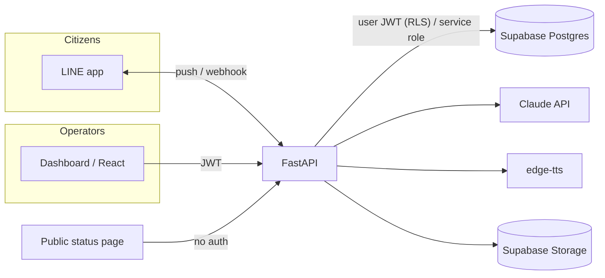
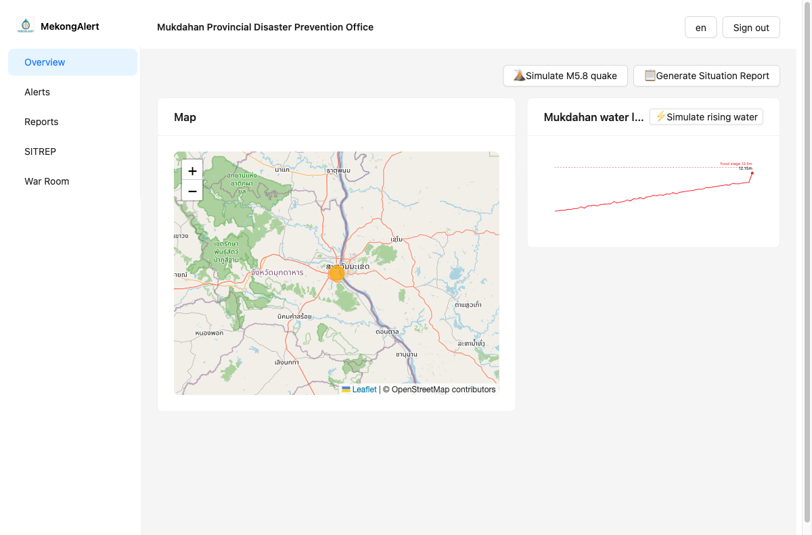
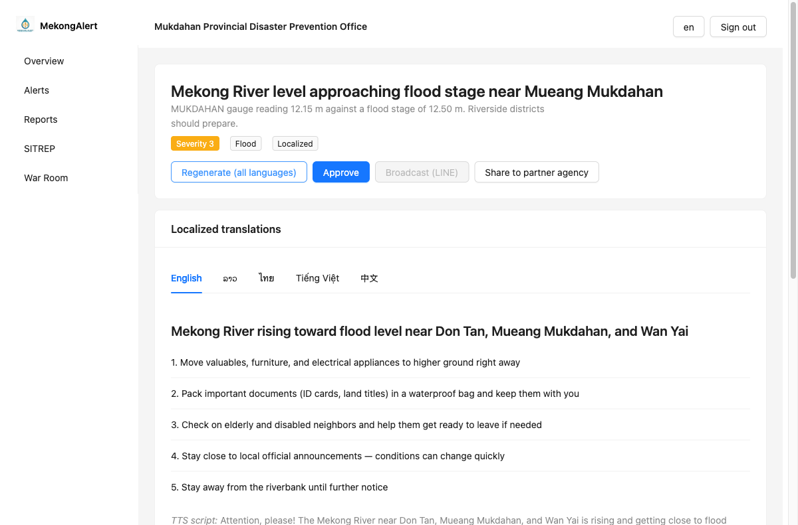
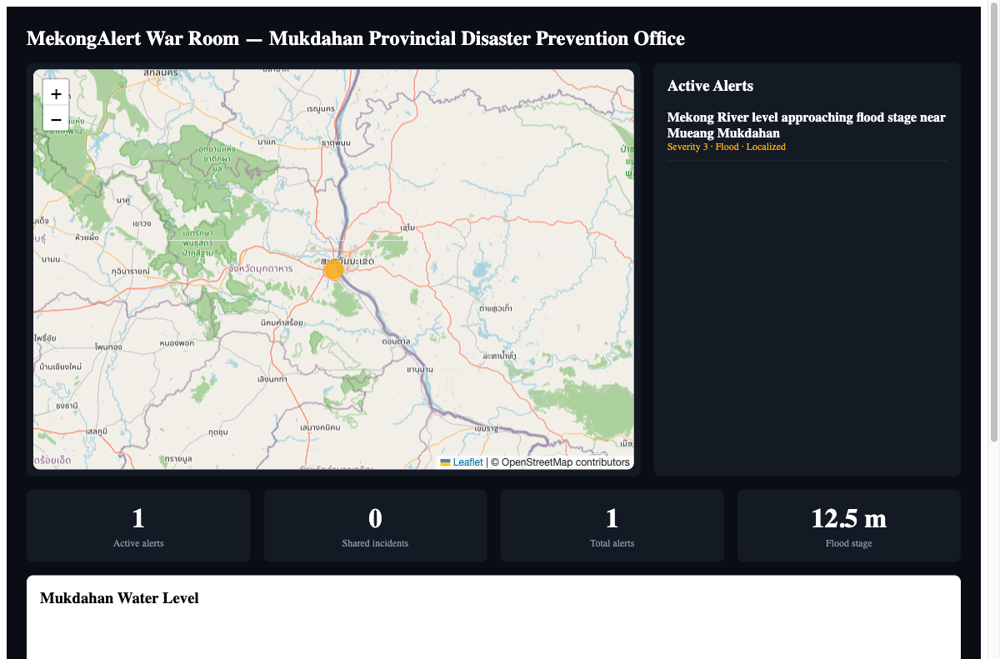
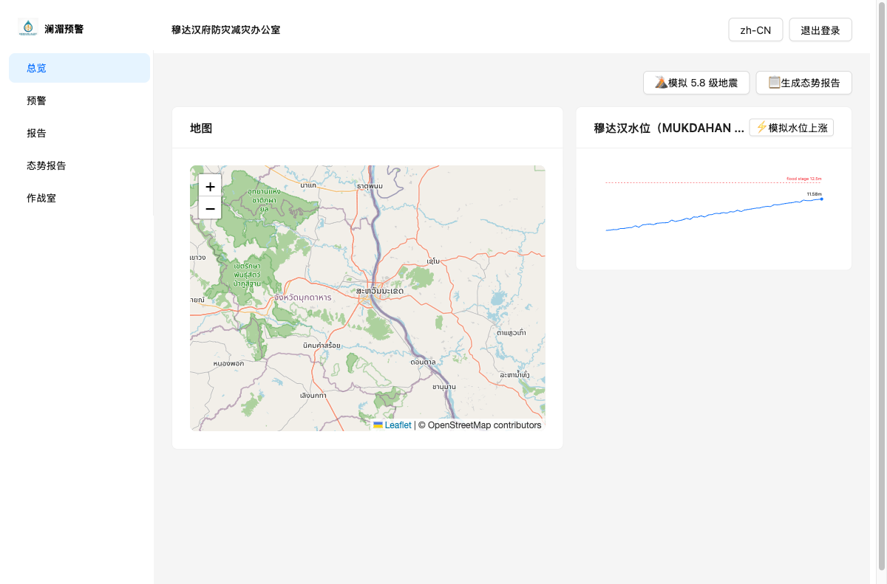

# MekhongAlert · เตือนภัยลุ่มโขง · 澜湄预警

Cross-border AI disaster alert & multilingual emergency communication platform.
Built for the 2026 China (Guangxi)–ASEAN "AI + Emergency Management" Innovation
Competition (Track 5).

MekhongAlert ingests disaster signals (river levels, weather warnings, operator
reports), uses an LLM to classify severity and rewrite bulletins into
plain-language, location-specific guidance in five languages (th, zh-CN, en,
lo, vi), then broadcasts through LINE push, a public status page, and TTS
voice bulletins for village loudspeaker towers. Citizens report back through
LINE with photos + location, triaged by AI onto a live map. The **Shared
Incident Room** lets an alert created by the Thai tenant (Mukdahan DDPM) be
shared with the Chinese tenant (Qinzhou Emergency Management Bureau) and read
instantly in their own language — the cross-border demo story (see
`MEKONGALERT_SPEC.md` §9 for the full script).

Full build spec, schema, prompts, and 7-day plan: [`../MEKONGALERT_SPEC.md`](../MEKONGALERT_SPEC.md).

### Proposal wording — 申报书「议题相关性」用语

For the proposal document's topic-alignment section:

> 本项目参加"高校与东盟特色"赛道，围绕中国—东盟应急管理在人工智能、信息交互、
> 协调联动方面的需求，构建跨境多语言灾害预警与应急协同平台。同时针对性回应
> 赛题8（防汛）中的灾情动态评估、次生灾害应对建议、人员转移与安置点推荐等
> 小场景，以及赛题12中的动态任务管理协同小场景；覆盖《"人工智能+应急管理"
> 应用场景开放清单》中监测预警、指挥救援、决策支持、政务服务四大方向。

(System name isn't slotted into the paragraph above — insert "澜湄预警（MekhongAlert）"
after "构建" if you want it named explicitly, e.g. "构建**澜湄预警（MekhongAlert）**跨境多语言灾害预警与应急协同平台".)

### Complements, not competes with, government Cell Broadcast

Thailand (and other governments) are rolling out Cell Broadcast Service —
tower-level emergency alerts that reach every phone with zero internet or app
install. MekhongAlert doesn't try to replace that (integrating with a national
CBS requires telecom/government-level access, well outside a 7-day build).
Instead it covers what Cell Broadcast structurally can't:

- **Two-way, not one-way.** CBS only pushes; it has no channel for a citizen
  to report back. MekhongAlert's LINE loop lets citizens send photos, text, or
  location, which AI triages onto the operator's live map (§6.4).
- **Plain-language, localized guidance**, not just a raw siren-style alert —
  5 languages with concrete action steps (§10.1), not a generic broadcast.
- **TTS for village loudspeakers** and **cross-border Shared Incident Room**
  between Thai and Chinese agencies — coordination CBS doesn't attempt.

## Tech stack

| Layer | Choice |
|---|---|
| Dashboard + public page + LIFF | React 19 + TypeScript + Ant Design + Vite |
| Backend | FastAPI (Python 3.12) |
| DB / Auth / Storage | Supabase (Postgres + RLS, Supabase Auth, Storage) |
| LLM | Anthropic Claude API |
| Messaging | LINE Messaging API |
| TTS | edge-tts |
| Map | Leaflet + OpenStreetMap |

## Architecture



- **Dashboard reads/writes go through FastAPI carrying the caller's Supabase
  JWT**, so Postgres Row Level Security is enforced exactly as if the
  frontend queried Postgres directly (see `api/app/deps.py`,
  `api/app/supabase_client.py`).
- **Webhook and broadcast fan-out use the service-role key** internally
  (no end-user JWT context available), enforcing tenant scoping in
  application code instead of RLS for `subscribers`, `citizen_reports`,
  `gauge_readings`.

## Screenshots

| | |
|---|---|
|  |  |
| Overview: live map pin + gauge chart crossing flood stage | AI Localization Engine: one click → 5 language cards |
|  |  |
| `/warroom` fullscreen big-screen dashboard | Dashboard chrome (nav, buttons, tenant name) switched to 中文 |

## Demo video script (~3:30) — extends `MEKONGALERT_SPEC.md` §9 with the WOW + competition-topic pack

1. **0:00–0:30** Overview dashboard: water-level chart climbing → press Simulate → chart crosses red flood line → auto-drafted flood alert pops up for 3 riverside districts.
2. **0:30–1:05** Open draft → click **AI Localize** → five language cards render (th, zh-CN, en, lo, vi) with plain-language guidance.
3. **1:05–1:30** Click **AI Impact Assessment → Generate** → bilingual assessment + ranked shelter recommendations render (maps to 赛题8's 灾情动态评估/次生灾害预测/人员转移安置点选择).
4. **1:30–1:50** Create a Response Task ("เปิดศูนย์พักพิงดอนตาล") on the Task Board (maps to 赛题12's 动态任务管理).
5. **1:50–2:15** Approve → Broadcast → cut to phone screen recording: LINE push arrives in Thai with severity color + actions.
6. **2:15–2:35** Citizen replies with flood photo + location → pin appears on the clustered report map, AI triage summary + credibility shown.
7. **2:35–2:55** Click **Share to 钦州市应急管理局** → switch to the Qinzhou account → same incident, Chinese UI, "shared from Thailand" badge, the task and a coordination-chat message auto-translated into Chinese. *(The cross-border money shot — hold on it.)*
8. **2:55–3:10** Switch the language toggle live on screen (en → th → zh-CN) — nav, buttons, and tenant name all flip instantly.
9. **3:10–3:30** Cut to `/warroom` fullscreen big-screen view, then play the TTS bulletin in Thai.

## Repo layout

```
web/        React 19 + Vite — dashboard, public status page, LIFF (/liff)
api/        FastAPI backend
supabase/   SQL migrations (schema + RLS)
seed/       Idempotent seed script + demo assets
```

## Local development

1. Copy env files and fill in Supabase/Anthropic/LINE credentials:
   ```
   cp .env.example .env
   cp web/.env.example web/.env
   ```
2. Apply the migration to your Supabase project (via the SQL editor, or
   `supabase db push` after `supabase link`).
3. Seed demo tenants/users/areas:
   ```
   cd seed && pip install -r ../api/requirements.txt
   set -a; source ../.env; set +a
   python seed.py
   ```
4. Run the API:
   ```
   docker compose up
   ```
   (or, without Docker: `cd api && pip install -r requirements.txt && uvicorn app.main:app --reload`)
5. Run the dashboard:
   ```
   cd web && pnpm install && pnpm dev
   ```

Demo logins: `viewer@mukdahan.demo` (public — password in the portfolio
listing), plus `op@`/`admin@mukdahan.demo` and `op@`/`admin@qinzhou.demo`
(private, rotated via `api/scripts/rotate_demo_passwords.py`; ask for current
credentials, they aren't in this repo).

## Production deployment

Live at `https://alert.harvesthubs.app` (frontend) and
`https://alert-api.harvesthubs.app` (API) on a Contabo VPS that already hosts
several other projects behind one shared Caddy reverse proxy (`aib-v2`
project, Cloudflare-proxied DNS in front of it):

- `/opt/mekongalert/` — API source + `docker-compose.prod.yml`, container
  `mekongalert-api` joins the `aib-v2_default` docker network (same pattern
  as `/opt/tuendee`) so Caddy can reach it by container name — no host port
  is published.
- `/opt/aib-v2/mekongalert/` — built static frontend (`vite build`, bind-mounted
  into the shared Caddy container at `/srv/mekongalert`).
- Caddy blocks for both domains live in the shared `/opt/aib-v2/Caddyfile`
  (backed up under `/opt/aib-v2/backups/` before editing); automatic HTTPS
  via Let's Encrypt works through Cloudflare's proxy the same way the other
  `harvesthubs.app` subdomains already do.
- **To redeploy after a code change**: rebuild+restart the API
  (`cd /opt/mekongalert && docker compose -f docker-compose.prod.yml up -d --build`)
  and/or re-run `vite build` locally and `rsync` `web/dist/` to
  `/opt/aib-v2/mekongalert/` — neither step touches the shared Caddy config,
  so there's no shared-downtime risk on routine redeploys.

## Build status

Building day-by-day per §13 of the spec; each day stops for review before
the next starts.

- [x] **Day 1** — repo scaffold, DB migration + RLS, auth, seed script, docker-compose
- [x] **Day 2** — alert model, composer drawer, alerts table, Leaflet overview map, gauge chart
- [x] **Day 3** — AI Localization Engine, translation tabs UI
- [x] **Day 4** — LINE OA: LIFF onboarding, broadcast push
- [x] **Day 5** — citizen webhook, AI triage, reports page with map pins
- [x] **Day 6** — Shared Incident Room, TTS voice bulletins, public status page, Simulate button
- [x] **Day 6.5 — WOW pack** — coordination chat with inline AI translation (W1),
  one-click AI SITREP (W2), Crowd Signal report corroboration + banner (W3),
  USGS earthquake ingest + Simulate quake button (W4), marker-clustered report
  map (W5), `/warroom` fullscreen big-screen dashboard (W6)
- [x] **Day 6.6 — competition-topic pack** — AI Impact Assessment + shelter
  ranking (W7, maps to 赛题8's 灾情动态评估/次生灾害预测/人员转移安置点选择),
  Response Task Board (W8, maps to 赛题12's 动态任务管理), both readable
  cross-tenant once shared, writable only by the owning tenant (RLS-verified)
- [x] **Day 7** — i18n dashboard chrome (en/th/zh-CN), severity-color/empty-state
  polish audit, deployed to production (`alert.harvesthubs.app` /
  `alert-api.harvesthubs.app`, Contabo VPS behind the shared Caddy reverse
  proxy), screenshots + extended demo script above
  — **remaining: record the demo video** (a human action — phone screen
  recording for the LINE push beat, per §9/above)

## Phase 2 roadmap (out of scope for the 7-day P0 build)

- Live MRC/TMD river-gauge and weather-warning ingestion (adapter interface
  already supports adding this — see `api/app/ingest/base.py`).
- Harvest Hub IoT river-level sensors as a hardware data source.
- WeChat / Zalo broadcast channels alongside LINE.
- Real SMS gateway fallback.
- GIS polygon geofencing (district-code + radius matching covers the demo).
- Native mobile apps.
